# PULSO

Plataformas 2.5D hecho en **Godot 4.7**. Eres **TSL-04**, una celda de carga que
despierta dentro de una computadora. Por donde pasas dejas una estela eléctrica
que, pasado un instante, mata: **correr es seguro, pararse no**.

Proyecto integrador de diseño para videojuegos (Tecmilenio) · Jose Guadalupe Rico Moreno

| | | |
|---|---|---|
| 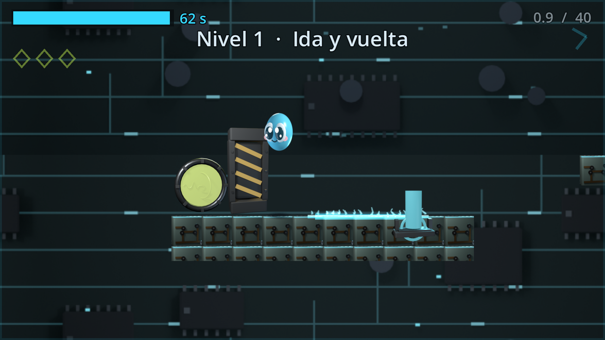 | 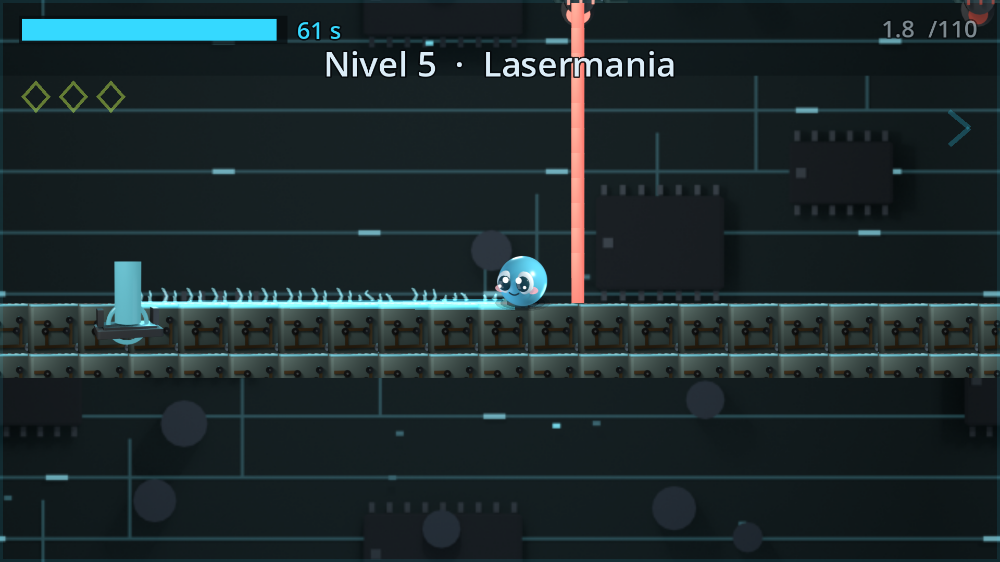 | 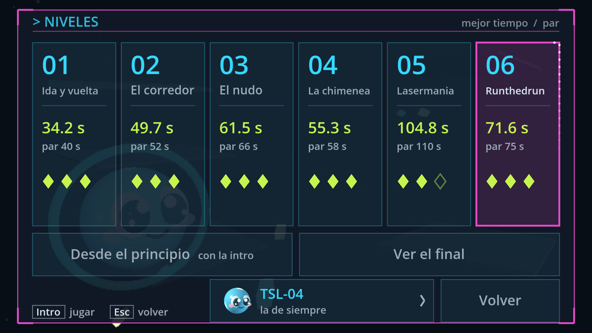 |

## Actividad 3: dónde se ve cada requisito

| Requisito | Dónde se ve |
|---|---|
| Implementación de sus mecánicas | [Mecánicas](#mecánicas) |
| Contar con una cinemática | [Vídeos de las cinemáticas](#cinemáticas) (intro y final) |
| Tener un inicio y un final | [Inicio y final](#inicio-y-final) |
| Arte propio en al menos el 50 % | [Arte propio](#arte-propio): **todo** el arte es propio, modelado y renderizado en Blender |
| Entregarse en un ejecutable | [Descargar e instalar](#descargar-e-instalar) (Windows y Mac) |

### Mecánicas

Correr, saltar (altura variable), impulso, adherencia y salto de pared, la **estela** que mata si te paras,
el **pulso** que la borra, la **carga** como vida y reloj, terminal > puerta > portal, fragmentos,
**balizas** (punto de control y recarga), láseres, drones que persiguen y cuatro personajes con
habilidades distintas.

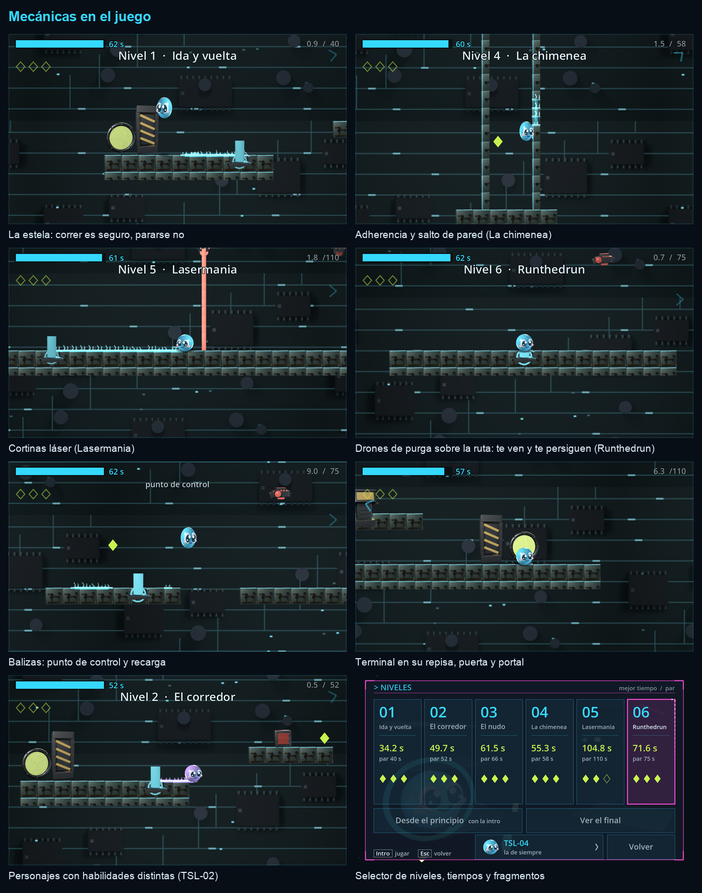

### Cinemáticas

Las dos cinemáticas del juego, grabadas del propio juego con su música. Aquí abajo se ve un fragmento
animado de cada una; los vídeos completos están en los enlaces.

| Intro | Final |
|---|---|
| 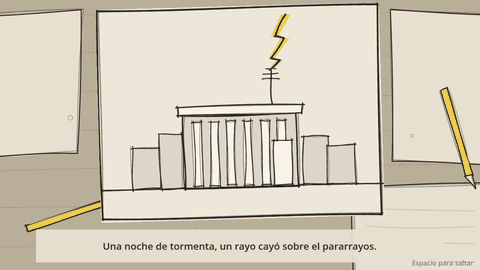 | 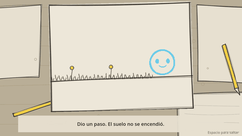 |
| **[Vídeo completo de la intro (1:08, MP4)](https://github.com/RMJ4G27020/PULSO/releases/download/v0.3-actividad3/cinematica_intro.mp4)** | **[Vídeo completo del final (0:37, MP4)](https://github.com/RMJ4G27020/PULSO/releases/download/v0.3-actividad3/cinematica_final.mp4)** |

Los vídeos también están en la carpeta [`media/`](media/) y en el [Release](../../releases/latest).

### Inicio y final

El juego empieza en el menú y la intro, y la historia acaba en la cinemática final (después del nivel 3),
con los niveles 4 a 6 como epílogo; al pasar el 6 se vuelve al menú.

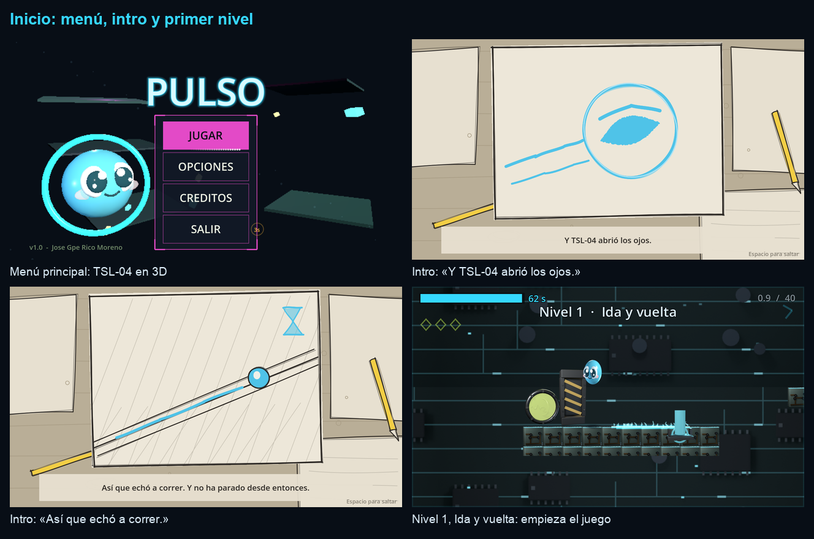

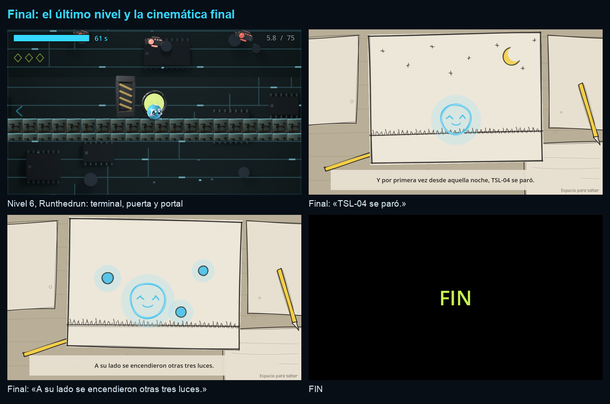

### Arte propio

Todo el arte del juego es propio: los personajes, los enemigos, los elementos, los niveles y el fondo se
**modelaron con scripts de Python en Blender** (`tsl04/build_*.py`) y se renderizaron a sprites desde ahí.
Las láminas de las cinemáticas, la música y los sonidos también se hicieron con scripts propios.

**Desde Blender** (cada modelo con sus materiales y su malla 3D):

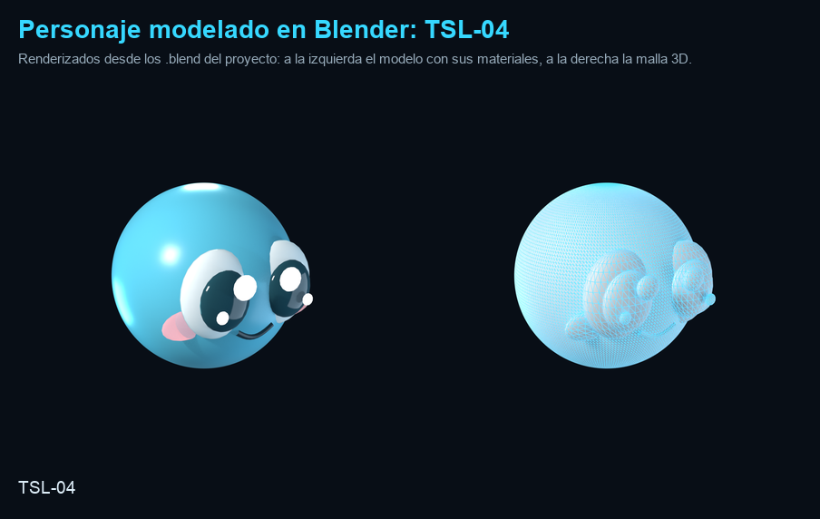

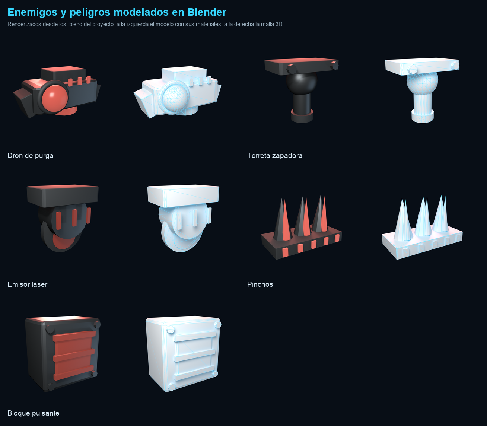

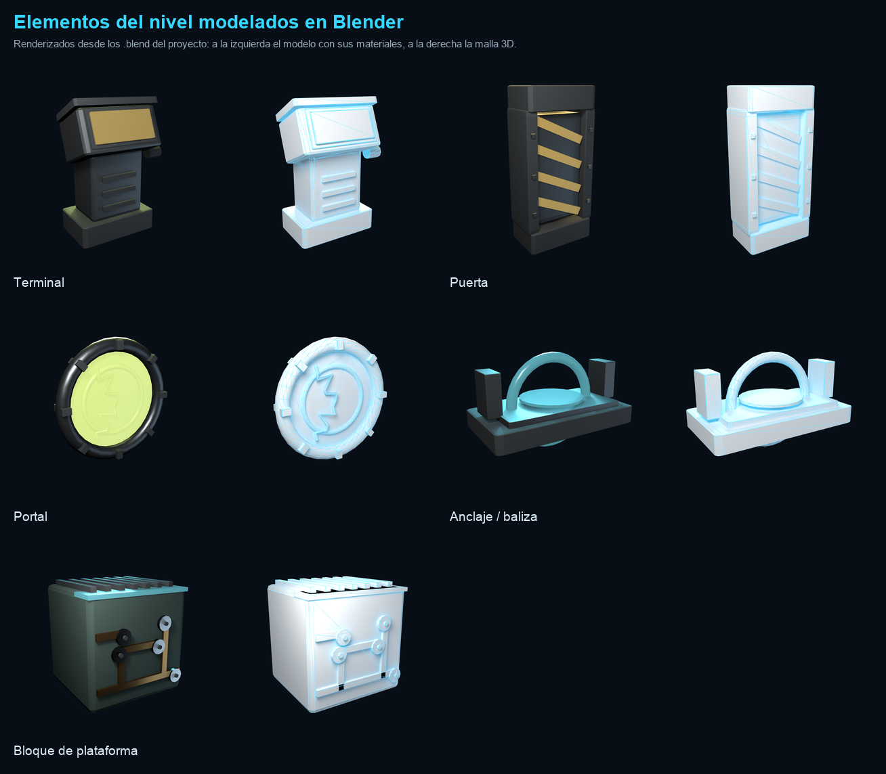

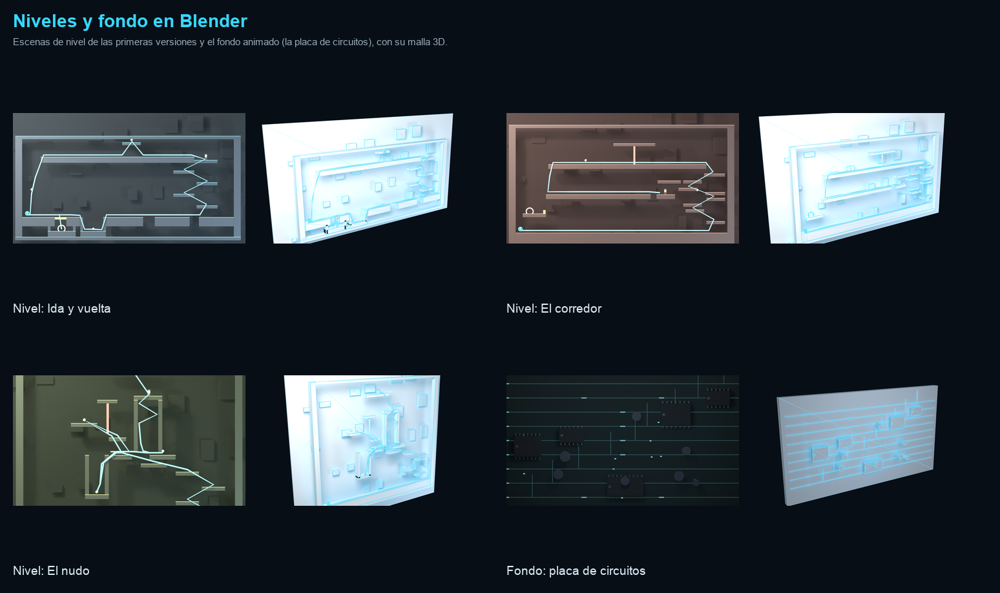

**En el juego** (los sprites que salen de esos renders):

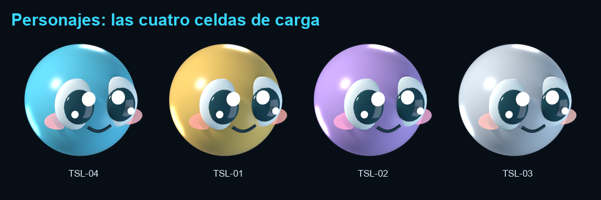

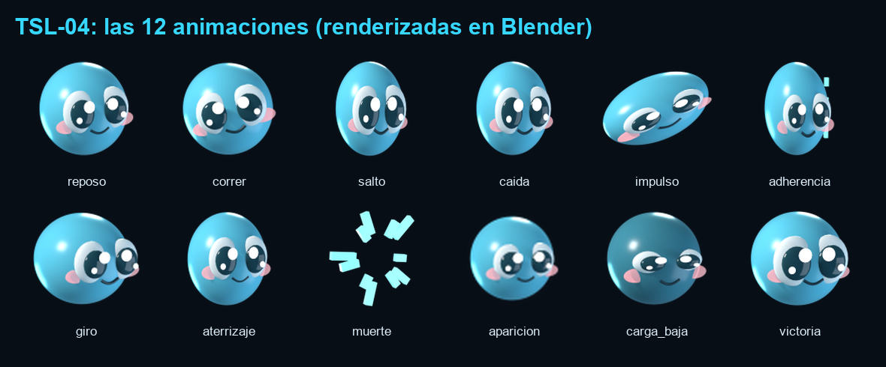

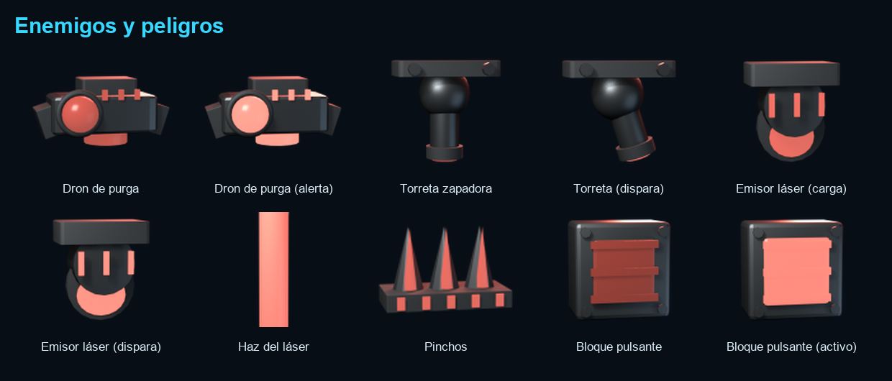

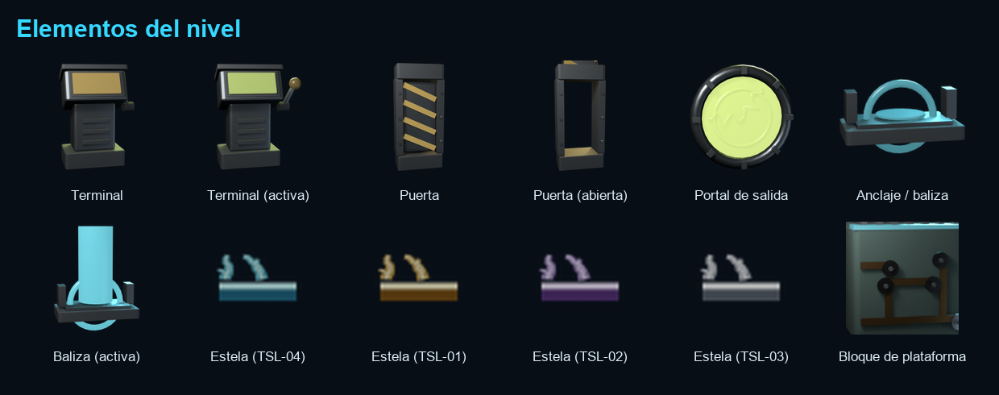

**Los seis niveles**, enteros:

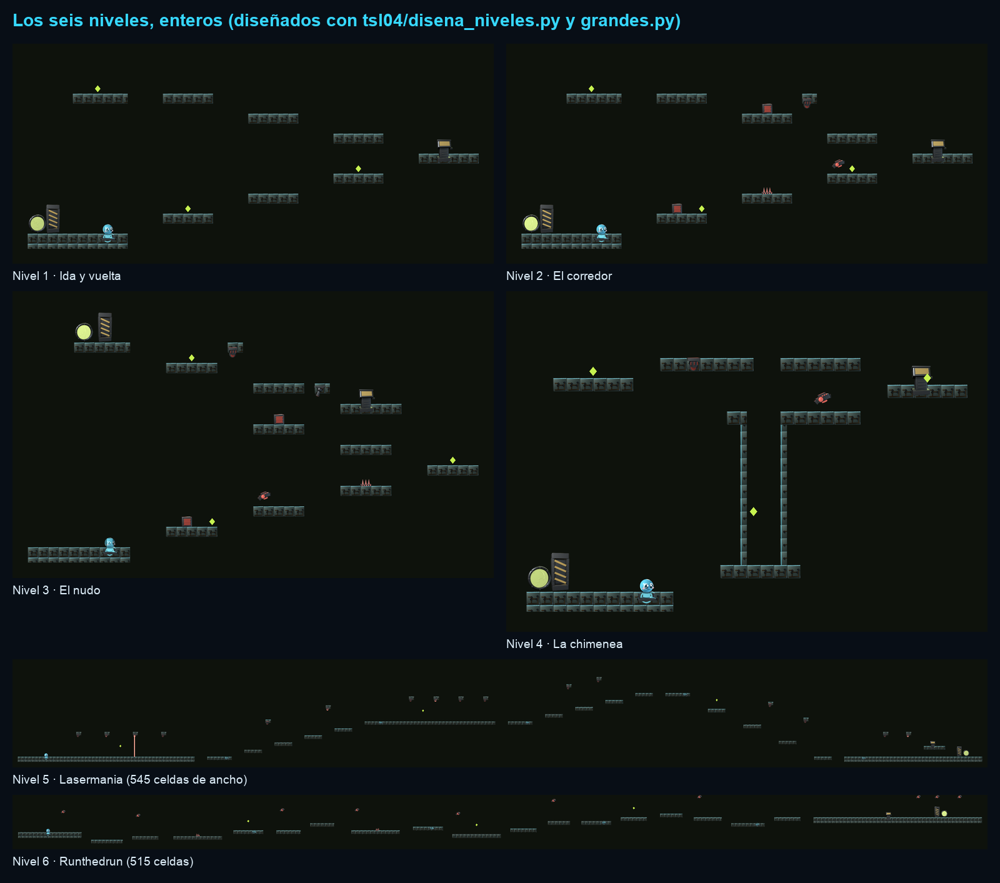

## Descargar e instalar

Las descargas están en **[Releases](../../releases/latest)**. No hace falta instalar nada más.

### Windows

1. Descarga **`PULSO-Windows.zip`**.
2. Descomprímelo (clic derecho > *Extraer todo*).
3. Abre **`PULSO.exe`**.
4. Si Windows muestra *"Windows protegió tu PC"*: **Más información > Ejecutar de todas formas**. Sale porque el ejecutable no está firmado.

### Mac (Intel o chip Apple)

1. Descarga **`PULSO-Mac.zip`** y ábrelo: se descomprime solo.
2. Arrastra **`PULSO.app`** a *Aplicaciones* (o déjala donde quieras).
3. La primera vez, **clic derecho sobre PULSO.app > Abrir > Abrir**. Sale el aviso porque no está firmada por Apple.
   Si aun así no abre: *Ajustes del Sistema > Privacidad y seguridad > Abrir igualmente*.

`PULSO_Actividad3.zip` lleva las dos versiones juntas: es la entrega de la Actividad 3.

El progreso se guarda solo.

## Controles

| Acción | Teclas |
|---|---|
| Moverse | Flechas o A / D |
| Saltar | Espacio, flecha arriba o W |
| Impulso | Shift o J |
| Pulso (borra la estela, cuesta carga) | Q |
| Terminal | Se acciona sola al quedarte encima (o E) |
| Reiniciar nivel | R |
| Pausa | Esc |

Las teclas se pueden cambiar en **OPCIONES**. En pantallas táctiles aparecen mandos en pantalla.

## Qué incluye

- **Mecánicas:** carrera y salto variable, impulso, adherencia y salto de pared, estela letal, pulso de reinicio, la carga como vida y reloj, terminal > puerta > portal, fragmentos coleccionables y balizas (puntos de control que recargan).
- **Cinemáticas:** la intro (cómo despierta TSL-04) y el final, después del nivel 3.
- **Seis niveles:** Ida y vuelta, El corredor, El nudo, La chimenea, **Lasermania** y **Runthedrun**.
- **Cuatro personajes:** TSL-04 y las tres celdas que despiertan con el progreso (TSL-01, 02 y 03), cada una con una ventaja y un coste.
- **Arte propio:** todo el arte (personajes, elementos, fondos, láminas de las cinemáticas, iconos) se genera con scripts de Python sobre Blender (`tsl04/`), y la música y los sonidos se sintetizan con scripts propios.

## Abrir el proyecto en Godot

1. Instala **Godot 4.7.2** (versión estándar, no .NET).
2. En el gestor de proyectos: **Importar** > `pulso-godot/project.godot`.
3. **F5** para jugar.

Para exportar, instala las plantillas de exportación (*Editor > Gestionar plantillas de exportación*) y usa los presets **Windows** o **macOS** (*Proyecto > Exportar*).

## Estructura

```
pulso-godot/   el juego (escenas, scripts, arte importado, pruebas en prueba/)
tsl04/         scripts del pipeline de arte, música y niveles (Blender + Python)
ficha_tienda/  capturas e iconos de la ficha de tienda
media/         vídeos de las cinemáticas e imágenes de este README
```

La documentación técnica está en [`pulso-godot/LEEME.md`](pulso-godot/LEEME.md) y el documento de diseño en [`pulso-godot/PULSO_GUIA_DEL_JUEGO.md`](pulso-godot/PULSO_GUIA_DEL_JUEGO.md).
